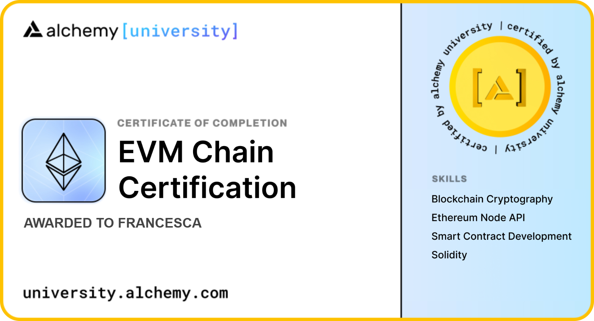

  <h1>Hi, I'm Francesca 👋</h1>
  
<strong>Backend Developer · Computer Science MSc Student · Curious by design</strong>

---

### 👩‍💻 A little about me

I turn requirements into **clean APIs, reliable services, and well-structured data**.

Since 2023, I have been working on enterprise applications in the financial sector, mainly with **Java, Spring Boot, Oracle, PL/SQL, and MyBatis**. I care about maintainable code, meaningful tests, and solutions that work beyond the happy path.

| Area | Technologies |
|:---|:---|
| **⚙️ Backend** | Java · Spring Boot · REST APIs  |
| **🗄️ Databases** | Oracle · PL/SQL · SQL · MySQL |
| **🧪 Testing** | JUnit · Spring Test · Postman |
| **🛠️ Tools & Workflow** | Git · Agile · Scrum |
| **🌱 Currently Exploring** | Solidity · Hardhat · Web3  |

### 🎓 Education

- **MSc in Computer Science — Software Techniques** *(in progress)*  
  Alma Mater Studiorum – University of Bologna
- **BSc in Computer Science**  
  University of L'Aquila
  
### 🏅 Certifications & Training

<table>
  <tr>
    <td>
      
    </td>
    <td>
      <strong>Alchemy University: EVM Chain Certification</strong> 
      Blockchain Cryptography · Ethereum Node API 
      Smart Contract Development · Solidity
    </td>
  </tr>
</table>

| Provider / Area | Certification or Skills |
|:---|:---|
| **OpenAI Academy** | [Extend Codex Workflows](https://oaiacademy.credential.net/92a9e166-30f8-49ec-b94d-a25709289b76?key=7f2c48f24ed8090ef54121c312164466ead3f4a284a3b6c0de5cd9a9406823eb) |
| **OpenAI Academy** | [AI Foundations](https://oaiacademy.credential.net/e6c36dd0-5955-41df-9591-aea6646baa45?key=eab6abb778802e8486d791631cc1a370fc384d90c3257aa5914c5838a980b1ab) |
| **OpenAI Academy** | [Agents and Workflows](https://oaiacademy.credential.net/9b40c698-2ce8-45ab-b20e-458aa906ecd3?key=649bb9be2e98bb114819869b0624ddfe2fdc3e9e22ab3bddfcc7bd7473e7db09) |
| **IBM SkillsBuild** | [Data Literacy](https://www.credly.com/badges/3d8dc650-3082-4712-984a-a226ce493cba/public_url) |
| **IBM SkillsBuild** | [Getting Started with Generative AI](https://www.credly.com/badges/bb75c485-3300-4fa2-8549-b706d464e125/public_url) |
| **IBM SkillsBuild** | [AI Fundamentals: Foundations for Understanding AI](https://www.credly.com/badges/cabf2f93-fffb-4b13-b8d4-288fd3e4242f/public_url) |
| **IBM SkillsBuild** | [Responsible AI and Risk Management](https://www.credly.com/badges/c5c5de2a-02e9-422d-a941-344cdc2e03b0/public_url) |
| **Confluent** | Fundamentals Accreditation |
| **Backend Development** | Spring Boot · MyBatis |
| **Databases** | MongoDB · Oracle PL/SQL |
| **Programming** | Python 3 |

### 🤖 AI Foundations — OpenAI Academy

- Completed: October 24, 2026
[View credential](https://oaiacademy.credential.net/e6c36dd0-5955-41df-9591-aea6646baa45?key=eab6abb778802e8486d791631cc1a370fc384d90c3257aa5914c5838a980b1ab)

### 🤖 Agents and Workflows — OpenAI Academy

- Completed: October 24, 2026
  [View credential](https://oaiacademy.credential.net/9b40c698-2ce8-45ab-b20e-458aa906ecd3?key=649bb9be2e98bb114819869b0624ddfe2fdc3e9e22ab3bddfcc7bd7473e7db09)
- Skills: Agent task scoping · Context gathering for agents · Draft generation and review · Agent output verification · Workflow improvement
